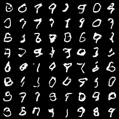

# APAN 5560 Assignment 3 - MNIST GAN

Repository: https://github.com/Haozhe07/APAN-5560-Assignment-3

An unconditional GAN generates 28 x 28 grayscale handwritten digits. The generator
and discriminator match Assignment3.pdf. The helper library follows the Module 6 activity:

- `helper_lib/model.py`: Generator, Discriminator, GAN bundle and `get_model("GAN")`.
- `helper_lib/trainer.py`: `train_gan(model, data_loader, criterion, optimizer, device, epochs)`.
- `helper_lib/generator.py`: `generate_samples(model, device, num_samples)` returns a PIL image grid.
- `app/main.py`: FastAPI integration; existing text, embedding and CIFAR-10 endpoints are preserved.

## Run with Docker

```sh
docker build -t apan5560-assignment3 .
docker run --rm -p 127.0.0.1:8000:80 apan5560-assignment3
```

Open http://localhost:8000/docs, or directly view a generated image:
http://localhost:8000/generate-image?count=16&seed=42

```sh
curl --fail 'http://localhost:8000/generate-image?count=16&seed=42' --output digits.png
```

GET `/generate-image` returns `image/png`. `count` is 1-64 (default 1), and
optional `seed` is 0 through 2^63-1. One sample is a 28 x 28 PNG; multiple samples
are arranged in a grid. A repeated seed produces the same noise and image in the
same runtime. Invalid parameters return 422; missing trained weights return 503.
This is an unconditional GAN, so it does not support choosing a digit label.
Some generated samples can be ambiguous; GAN losses do not measure classification accuracy.

The Docker image contains the trained generator. It does not download MNIST or
train a model at startup. CPU-only PyTorch wheels are used on Linux.

## Local run

Install Python 3.13 and uv, then:

```sh
uv sync --frozen
uv run python -m spacy download en_core_web_lg
uv run fastapi run app/main.py --port 8000
```

The spaCy download supports the preserved `/embedding` endpoint; GAN generation
works independently of that endpoint. Other preserved routes are POST `/generate`
and POST `/classify` (CIFAR-10 image upload).

## Included training run

The included generator was trained for **10 epochs on all 60,000 training images**.
Fixed-noise grids from each epoch are in `examples/epoch_01.png` through
`examples/epoch_10.png`. The local checkpoint recovery was exercised before the
last two epochs. No digit labels are used to train this unconditional GAN.

## Reproduce training

```sh
uv run python train.py --epochs 10
```

All 60,000 MNIST training images are normalized from [0,255] to [-1,1], matching
the generator's Tanh output. The training script calls the helper-library trainer.
Adam is used for both networks (learning rate 0.0002, betas 0.5/0.999), with binary
cross-entropy, batch size 256, and seed 42. Discriminator outputs are probabilities
using Sigmoid, so BCELoss is used rather than BCEWithLogitsLoss. During the
D update, generated images are detached. During the G update, discriminator
parameters are frozen while gradients still flow through D to G.

`models/generator.pt` contains the inference weights; `models/metrics.json`
records actual epoch losses and times. Sample grids for fixed noise are saved
under `examples/`. Resume an interrupted run with `--resume`; the local training
checkpoint includes optimizer and RNG states and is excluded from Git/Docker.
GPU training is not required. Generated samples use evaluation mode so BatchNorm
uses stored statistics during inference.

## Verification

```sh
uv run python verify.py
```

Checks include exact convolution settings, network output ranges/shapes, updates
to both networks, finite training losses, evaluation BatchNorm, PNG output,
seed repeatability, grid dimensions, invalid request handling, missing weights,
and preserved text/CNN routes.

The written theory answers are in `docs/Assignment3_Theory_Answers.pdf` and
`theory_answers.md`. Calculations show all steps; conceptual answers are concise.

## Actual HTTP-generated sample

The following image was downloaded from the running Docker API with
`/generate-image?count=64&seed=42` after the ten-epoch training run.


